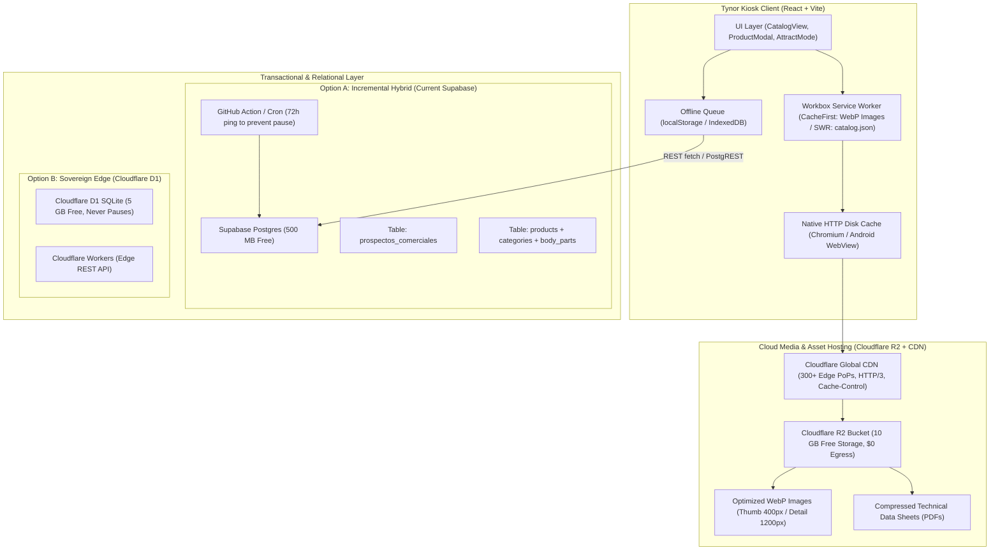

# Project: Tynor Kiosk Online Database & Image Storage Architecture

## Architecture Overview
A decoupled hybrid cloud architecture optimized for an interactive commercial catalog (100–1,000 products, up to 5 GB of images and technical PDFs) deployed across React/Vite, Electron, and Capacitor (Android APK), operating under zero-cost free-tier infrastructure.

### System Architecture Diagram


---

## Feature Inventory
| # | Feature | Description | Milestone | Source |
|---|---------|-------------|-----------|--------|
| F1 | Supabase Feasibility Assessment | Evaluate existing `src/services/supabase.js`, 500 MB DB, 1 GB Storage limit, 2 GB egress limit, and 7-day inactivity pause | M1 | Survey (explorer_codebase, spec_quotas) |
| F2 | Multi-Provider Free-Tier Comparison | Rigorous comparison of Supabase, Firebase Spark, Cloudflare D1/R2, Cloudinary, and PocketBase across all quota dimensions | M1 | Survey (spec_quotas) |
| F3 | Unified vs Hybrid Architectural Analysis | Trade-off analysis between single-provider unified stacks vs hybrid architectures (DB + dedicated asset store/CDN) | M1 | Survey (explorer_caching, spec_quotas) |
| F4 | Kiosk Bandwidth & Caching Mathematics | Empirical consumption models for 100–1,000 products & up to 5 GB images across 3 caching scenarios | M1 | Survey (explorer_caching) |
| F5 | Target Platform Compatibility Validation | Verification across React/Vite, Electron (embedded loopback HTTP server), and Capacitor Android (WebView permissions) | M1 | Survey (explorer_codebase, explorer_caching) |
| F6 | Product Catalog Relational Schema Design | SQL schema supporting 15 attributes (prices, stock, sizes, colors, body part, categories, PDFs, videos) for Postgres & SQLite | M2 | Survey, Worker, Reviewer 2 |
| F7 | Media Pipeline & Asset Optimization Plan | Two-tier WebP image pipeline + PDF compression strategy reducing 983 MB assets down to free-tier sustainability | M2 | Survey (explorer_codebase, explorer_caching) |
| F8 | Kiosk Client Integration & Caching Guide | Actionable implementation blueprints: Service Worker runtime cache, HTTP headers, offline lead queue resilience | M3 | Survey, Worker, Challenger 1 |
| F9 | Final Recommendations & Trade-Off Matrix | Concrete verdict, migration roadmap from static mock to cloud DB, and operational guardrails | M3 | Survey (all explorers) |

---

## Milestones
| # | Name | Scope | Dependencies | Status |
|---|------|-------|-------------|--------|
| M1 | Comparative Evaluation & Architecture Report | F1, F2, F3, F4, F5: Master comparative technical evaluation and quota matrix document | none | DONE |
| M2 | Schema Design & Media Pipeline Specification | F6, F7: SQL schemas (Postgres + D1), product data models, and WebP/PDF optimization pipeline | M1 | DONE |
| M3 | Kiosk Integration Blueprint & Final Guidance | F8, F9: Client integration code, caching architecture, final decision matrix, and migration roadmap | M2 | DONE |
| M4 | Review, Adversarial Stress Testing & Forensic Audit | Verification, challenger empirical validation, and forensic integrity audit | M3 | DONE |

---

## Interface Contracts

### Product Entity Schema (`products`)
```json
{
  "code": "string (PK, e.g. '101', 'K10', 'D58')",
  "name": "string (e.g. 'Inmovilizador de Rodilla')",
  "cat_id": "string (FK to categories.id)",
  "price": "numeric(10,2) nullable (9 active prices, 171 nulls)",
  "stock": "integer default 0",
  "body_part": "string (FK to body_parts.id, e.g. 'rodilla', 'tobillo')",
  "badge": "string nullable (e.g. 'Nuevo', 'Destacado')",
  "linea": "string ('ORTOPEDIA', 'Deportiva', 'REHABILITACION')",
  "sizes": "jsonb / text array (e.g. ['CH', 'M', 'G', 'XL'])",
  "colors": "jsonb array (e.g. [{'id': 'beige', 'name': 'Beige', 'hex': '#D4B996'}])",
  "has_pdf": "boolean default false",
  "has_video": "boolean default false",
  "short_desc": "text",
  "description": "text",
  "uses": "jsonb / text array (indexed with GIN)",
  "features": "jsonb / text array (indexed with GIN)",
  "fts": "tsvector generated column for Spanish full-text search",
  "image_thumb_url": "string (CDN URL to 400x400 WebP)",
  "image_detail_url": "string (CDN URL to 1200x1200 WebP)",
  "pdf_url": "string nullable (CDN URL to compressed PDF)",
  "video_url": "string nullable (CDN URL to MP4 video)",
  "is_active": "boolean default true",
  "created_at": "timestamptz default now()",
  "updated_at": "timestamptz default now()"
}
```

### Media CDN URL Contract
```
Base CDN URL: https://media.tynorcatalog.com
- Thumbnails (Grid View): /images/thumb/{code}.webp?v={updated_at} (Cache-Control: public, max-age=31536000, immutable)
- Details (Modal View):   /images/detail/{code}.webp?v={updated_at} (Cache-Control: public, max-age=31536000, immutable)
- Technical Sheets:      /pdf/{code}.pdf (Cache-Control: public, max-age=604800)
- Videos:                /video/{code}.mp4 (HTTP Range Requests 206)
- Universal Vector Fallback: /assets/placeholder-product.svg
```

---

## Code Layout & Deliverables
- Evaluation Report: `docs/DATABASE_AND_STORAGE_EVALUATION.md`
- Schema & Data Migration: `docs/DATABASE_SCHEMA_AND_MIGRATION.md`
- Client Integration & Caching: `docs/KIOSK_CACHING_AND_INTEGRATION_GUIDE.md`
- Migration Generator: `scripts/generate_migrations.cjs`
- SQL Seeds: `scripts/supabase_seed.sql` & `scripts/d1_seed.sql`
- Universal Vector Fallback: `public/assets/placeholder-product.svg`
- Resilient Image Component: `src/components/KioskImage.jsx`
- Second Brain Syntheses:
  - `c:/Users/User/Documents/vault/pages/syntheses/2026-11-02-CatalogoTyn-BaseDatos-Storage-Recomendacion.md`
  - `c:/Users/User/Documents/vault/pages/syntheses/2026-11-02-CatalogoTyn-Remediacion-Esquema-D1-Kiosco.md`
